# Obstacle Avoidance with the Niryo Ned2 Manipulator using the CHOMP Optimizer

Motion planning for a **pick-and-place** task with the **Niryo Ned2** 6-DoF manipulator in MATLAB, using **CHOMP** (Covariant Hamiltonian Optimization for Motion Planning) to generate smooth, collision-free joint-space trajectories around a shelf. The project also probes CHOMP's limits caused by its **sphere-based approximation** of the robot and obstacles.

> Course project for *Dynamical Systems Theory*
> M.Sc. in Automation Engineering — Politecnico di Bari, A.Y. 2024-2025
> **Authors:** Angelo Gregucci, Leonardo Li Bergolis
> **Supervisors:** Prof. Ing. Mariagrazia Dotoli, Ing. Raffaele Carli, Ing. Fabio Mastromarino
>
> 📄 Full report (Italian): [`docs/Tesina_Team_A1-9.pdf`](docs/Tesina_Team_A1-9.pdf) · 📊 Slides: [`docs/presentation.pptx`](docs/presentation.pptx) · 🎬 Simulation video: [`media/pick_and_place_simulation.mkv`](media/pick_and_place_simulation.mkv)

<p align="center">
  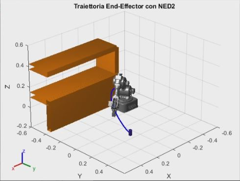
  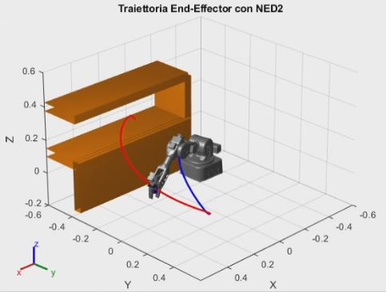
</p>

---

## Overview

1. Import the Ned2 model (SDF) with joint limits and home configuration.
2. Build a simulation scene: a two-level **shelf** on one side of the robot (upper shelf height set by a parameter `b`) and a small **cylinder** to be picked on the other side.
3. Run a **workspace analysis** with the **Yoshikawa manipulability index** to choose reachable, well-conditioned pick and place points.
4. Solve **inverse kinematics** for the pick and place poses.
5. Approximate obstacles and robot with **spheres** and optimize two trajectories with `manipulatorCHOMP`: *home → pick* and *pick → place*.
6. Animate the robot carrying the cylinder along the optimized end-effector path.
7. Stress-test CHOMP by lowering the upper shelf until the sphere approximation makes the task infeasible.

## The robot: Niryo Ned2

<p align="center">
  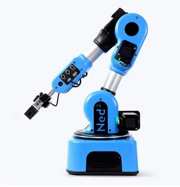
  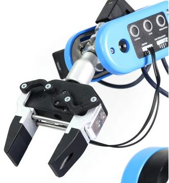
</p>

A 6-DoF collaborative manipulator designed for education and research, mounted with the custom gripper.

| Payload | Accuracy | Reach | Weight |
|:---:|:---:|:---:|:---:|
| 300 g | ±0.5 mm | 490 mm | 7 kg |

## CHOMP in a nutshell

CHOMP optimizes a trajectory $\xi$ by minimizing a cost functional that trades off smoothness against obstacle proximity:

$$
U[\xi] = F_{smooth}[\xi] + \lambda\,F_{obs}[\xi]
$$

$$
F_{smooth}[\xi] = \frac{1}{2}\int_0^1 \left\lVert \frac{d\xi(t)}{dt} \right\rVert^2 dt,
\qquad
F_{obs}[\xi] = \int_0^1\!\!\int_B c\big(x(\xi(t),u)\big)\left\lVert \frac{d}{dt}x(\xi(t),u) \right\rVert du\,dt
$$

where $c(\cdot)$ is an obstacle cost field in the workspace and $x(q,u)$ is the forward kinematics of body point $u$. The trajectory is improved by **covariant gradient descent**:

$$
\xi_{i+1} = \xi_i - \frac{1}{\mu} A^{-1}\,\nabla U[\xi_i]
$$

Unlike sampling-based planners such as RRT, which find a feasible path quickly but often a jerky one, CHOMP refines an initial guess into a smooth, locally optimal trajectory. This suits static, moderately cluttered scenes.

## Simulation environment

| Scene | Sphere approximation used by CHOMP |
|:---:|:---:|
| 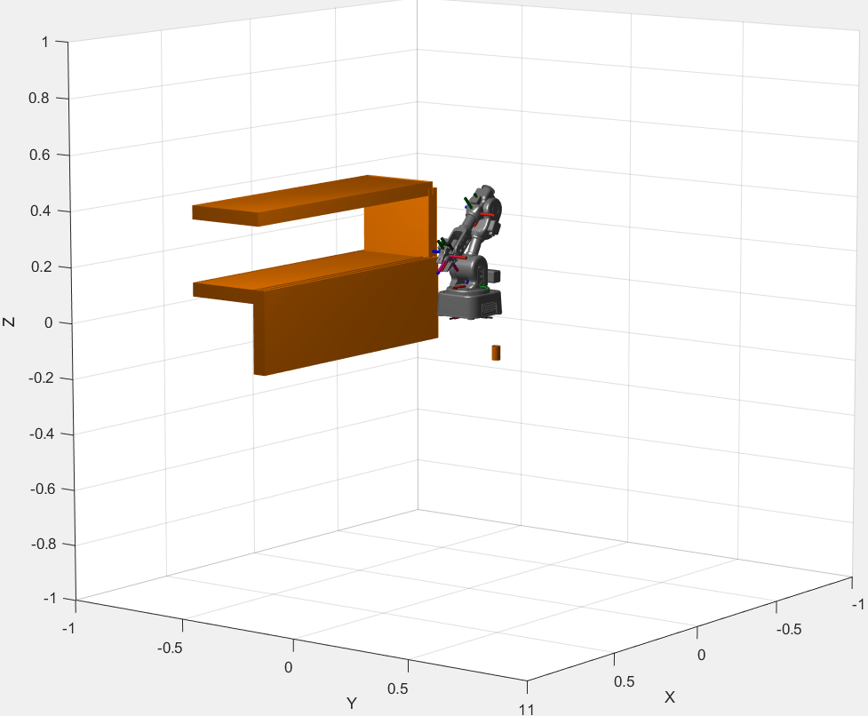 | 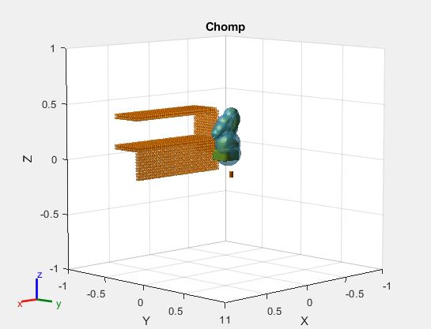 |

The shelf walls are `collisionBox` objects and the target is a `collisionCylinder`. They are converted into spherical obstacles (20 spheres per metre) and passed to `chomp.SphericalObstacles`.

## Workspace analysis — Yoshikawa index

`generateRobotWorkspace` samples reachable end-effector positions (accounting for the obstacles), and `manipulabilityIndex` scores each configuration with the Yoshikawa index

$$
w(q) = \sqrt{\det\big(J(q)\,J^\top(q)\big)}
$$

The pick point (where the cylinder sits) and the place point on the shelf are chosen from this set. They are then converted to joint space with `inverseKinematics`.

<p align="center">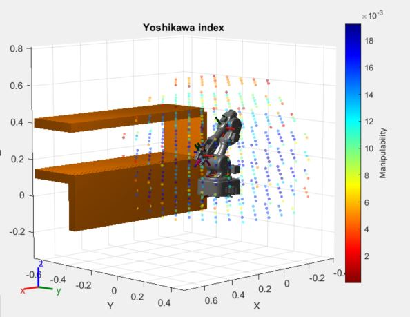</p>

## Trajectory optimization

Two trajectories are optimized with `optimize(manipulatorCHOMP, ...)`, using a **minimum-jerk polynomial** (`minjerkpolytraj`) as the initial guess, over 5 s with a 0.1 s step:

1. **home → pick** (blue path)
2. **pick → place** (red path)

| Parameter | Value |
|---|---|
| `SolverOptions.LearningRate` | 5 |
| `SmoothnessOptions.SmoothnessCostWeight` | 1e-3 |
| `CollisionOptions.CollisionCostWeight` | 1 |

The resulting joint trajectories are smooth, collision-free and within the Ned2 joint limits.

<p align="center">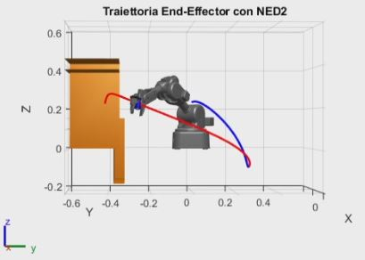</p>

## Limits of CHOMP — sphere over-approximation

Spheres always **over-estimate** the real volume of the robot and the obstacles. In addition, the cost function can prefer a path that briefly crosses a collision zone over one that stays collision-free but close to obstacles. To expose this, the gap between the two shelves is reduced through the parameter `b`:

| | CHOMP sphere model | Real robot |
|---|:---:|:---:|
| **Case 1** — `b = 0.10`: feasible, collision-free | 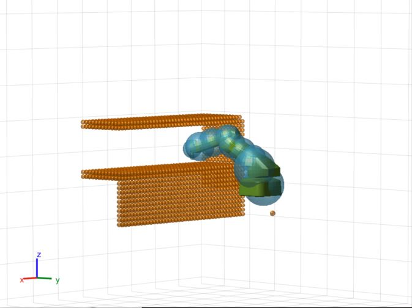 | 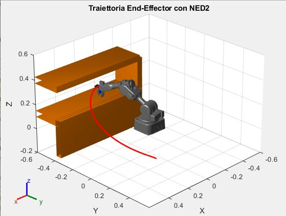 |
| **Case 2** — `b = 0.15`: real robot would fit, but the spheres collide | 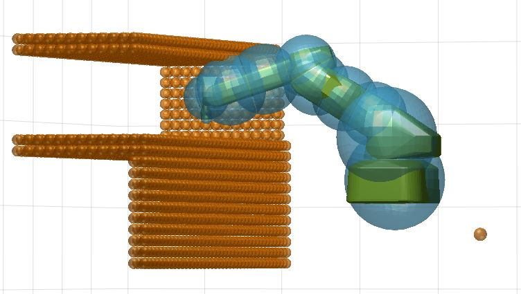 | 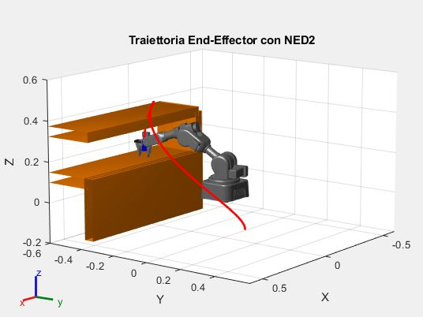 |

In case 2 the real manipulator would fit through the gap, but its sphere approximation does not. CHOMP therefore returns a trajectory that collides with the obstacle.

## Conclusions

- CHOMP produces **very smooth** trajectories and exposes tunable parameters (learning rate, cost weights, sphere resolution).
- The **sphere approximation is conservative**. In narrow spaces it can make feasible motions look infeasible, or push the optimizer into colliding solutions. Smaller spheres (higher resolution) reduce the problem at a higher computational cost.
- For high-precision motions in tight, cluttered spaces, other planners may be preferable.

**Future work:** a **learning-based CHOMP**, where a neural network trained on a dataset of optimal trajectories imitates CHOMP updates. This would give faster planning, better generalization to unseen scenes and more robustness to noisy environment models.

---

## Repository structure

```
.
├── src/
│   ├── main_chomp_pick_place.mlx                         # main MATLAB Live Script
│   ├── main_chomp_pick_place.m                           # plain-text export of the live script
│   ├── ned2_import.m                                     # imports Ned2 (SDF) + joint limits + home config
│   ├── new_ned2.sdf                                      # Ned2 robot description
│   ├── exampleHelperApproximateCollisionBoxSpheres.m     # box → spheres
│   └── exampleHelperApproximateCollisionCylinderSpheres.m# cylinder → spheres
├── docs/
│   ├── Tesina_Team_A1-9.pdf                              # full report (Italian)
│   ├── presentation.pptx                                 # project slides
│   └── img/                                              # figures
└── media/
    └── pick_and_place_simulation.mkv                     # simulation recording
```

## How to run

**Requirements:** MATLAB with the **Robotics System Toolbox**. R2024b or later is recommended, since `generateRobotWorkspace` and `manipulabilityIndex` are needed for the workspace analysis.

```matlab
cd src
main_chomp_pick_place      % or open main_chomp_pick_place.mlx
```

Change `b` (upper shelf height) and `a` (shelf-robot distance) in the *Generazione Ambiente* section to reproduce the two test cases.

> **Note on meshes:** `new_ned2.sdf` references the Ned2 visual meshes in `collada/*.dae`, which are not included in this repository. Without them the robot is imported with collision geometry only. The meshes are available in Niryo's official [`ned_ros`](https://github.com/NiryoRobotics/ned_ros) repository (`niryo_robot_description/meshes`). Copy them into `src/collada/` to get the full visuals.

## References

1. M. Zucker et al. — *CHOMP: Covariant Hamiltonian Optimization for Motion Planning*, The International Journal of Robotics Research 32(9-10), pp. 1164–1193, 2013.
2. M. Kalakrishnan et al. — *STOMP: Stochastic Trajectory Optimization for Motion Planning*, IEEE ICRA 2011, pp. 4569–4574.
3. J. Schulman et al. — *Finding Locally Optimal, Collision-Free Trajectories with Sequential Convex Optimization*, Robotics: Science and Systems, 2013.
4. H. Zhang et al. — *Path Planning of Industrial Robot Based on Improved RRT Algorithm in Complex Environments*, IEEE Access 6, pp. 53296–53306, 2018.
5. Niryo — [Ned2](https://niryo.com/) and Ned2 Custom Gripper.
6. MathWorks — [Robotics System Toolbox](https://www.mathworks.com/products/robotics.html) · [`manipulatorCHOMP`](https://www.mathworks.com/help/robotics/ref/manipulatorchomp.html).
7. MathWorks — *Train Deep-Learning-Based CHOMP Optimizer for Motion Planning* (example).

## Credits

`ned2_import.m` and the Ned2 SDF model were provided by Ing. Fabio Mastromarino. The `exampleHelper*` functions come from MathWorks Robotics System Toolbox examples.
